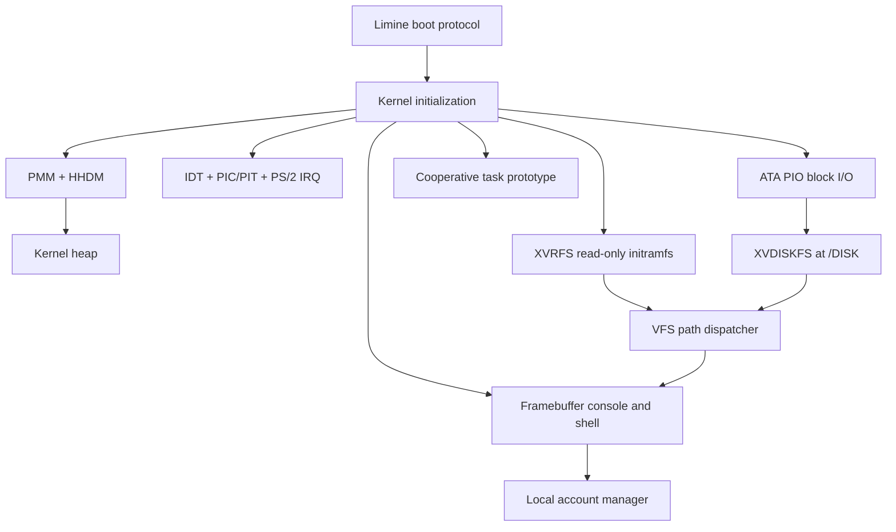

# XavierOS Architecture

XavierOS runs as one freestanding x86_64 kernel. Most facilities are kernel-resident prototypes; user-mode isolation and a stable external application ABI do not exist yet.

## Boot sequence

1. Limine loads the kernel ELF and provides memory-map, framebuffer, and HHDM responses.
2. Kernel startup validates required responses and initializes serial output and console services.
3. The physical page allocator manages the supported usable pages below 4 GiB. HHDM maps supported physical memory into a direct-access virtual range.
4. The kernel heap reserves a contiguous run of pages and provides a first-fit allocator.
5. The IDT, PIC/PIT, and keyboard path are initialized. IRQ handlers are intentionally small and do not allocate or perform disk I/O.
6. The embedded XVRFS image is parsed read-only. ATA PIO is probed and the test disk is mounted at `/DISK` when valid.
7. The console and shell start. `SELFTEST` exercises available subsystems.

## Memory

PMM allocates physical pages. HHDM provides direct access to supported physical memory. The heap is a small first-fit allocator over a contiguous HHDM-mapped range. PMM and heap are single-core prototypes, not a complete virtual-memory or SMP-safe allocator design.

## Interrupts and tasks

PIT IRQ0 updates the timer counter. Keyboard IRQ1 places scan codes in a bounded ring buffer. The task subsystem is cooperative: tasks must yield; PIT does not preempt them. Do not perform synchronous disk I/O or heap allocation in IRQ handlers.

## Filesystems

- **XVRFS v1** is a read-only initramfs image generated from `rootfs/` and embedded into the kernel.
- **XVDISKFS v1** is a small writable filesystem on the QEMU primary IDE master.
- The VFS dispatches paths between the embedded root and writable `/DISK` mount.

See [XVRFS-FORMAT.md](XVRFS-FORMAT.md) and [XVDISKFS-FORMAT.md](XVDISKFS-FORMAT.md).

## User accounts

The local account manager stores a small user database on the writable disk. Account checks and path restrictions are enforced by shell commands running in ring 0; this is not a hardened security boundary or user-mode isolation.

## Design constraints

- Keep IRQ handlers bounded and allocation-free.
- Validate all on-disk lengths, indexes, parent chains, and sector ranges before use.
- Use only disposable virtual disks for testing.
- Do not claim a feature is verified until the relevant build and runtime test actually passes.
