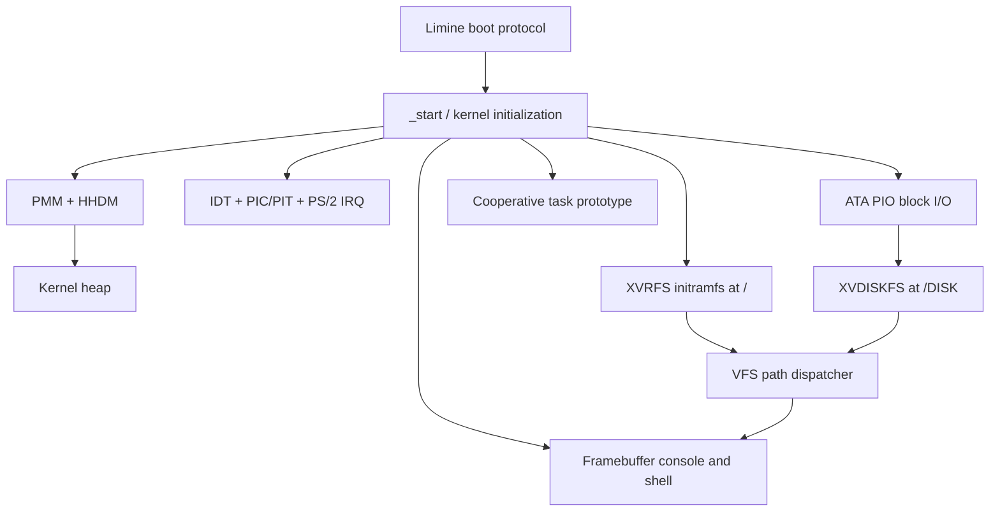

# XavierOS Architecture

XavierOS currently runs as one freestanding x86_64 kernel. Most features are kernel-resident prototypes; user-mode isolation and a stable external application ABI do not exist yet.

## Boot sequence

1. Limine loads the kernel ELF and provides memory-map, framebuffer, and HHDM requests.
2. `_start` validates the required Limine responses and initializes serial output/console services.
3. The physical page allocator uses a bitmap for supported usable pages below 4 GiB. HHDM translates physical addresses into a direct-mapped virtual range.
4. The kernel heap reserves a contiguous run of pages and exposes a first-fit global allocator.
5. The IDT, PIC/PIT, and keyboard path are initialized. IRQ handlers are intentionally small and do not allocate or perform disk I/O.
6. The embedded XVRFS image is parsed read-only. ATA PIO is probed; if the attached disposable disk contains a valid XVDISKFS superblock, it is mounted at `/DISK`. An all-zero LBA0 is treated as a blank test disk and initialized; an unknown non-zero signature is rejected.
7. The shell starts and `SELFTEST` exercises the available subsystems.

## Memory model

PMM allocates physical pages. HHDM makes the supported portion of physical RAM directly accessible to the kernel. The heap is a 1 MiB first-fit free list stored in one contiguous HHDM-mapped range. The heap/PMM are single-core prototypes; they are not a complete virtual-memory subsystem or an SMP-safe allocator design.

## Interrupt model

The IDT contains CPU exception stubs and hardware IRQ entries. Legacy PIC remapping keeps hardware IRQs outside the CPU exception vector range. PIT IRQ0 increments a counter; keyboard IRQ1 records scan codes in a bounded ring buffer. Scheduling is **not** performed from PIT yet. Disk reads/writes poll ATA status synchronously and must not be invoked from an IRQ handler.

## Filesystems

- XVRFS v1 is an embedded read-only initramfs generated from `rootfs/` and included at build time.
- XVDISKFS v1 stores a fixed metadata table and contiguous file extents on the QEMU primary IDE master. It supports basic file/directory operations and mount-time validation.
- VFS dispatches paths between the embedded root and the synthetic writable mount at `/DISK`.

XVDISKFS is not journaled or crash-safe. A failed write or power loss can leave data or metadata inconsistent. The writable image must be treated as disposable test data.

## Tasks

`task.rs` implements a small cooperative scheduler prototype. Tasks have static stacks and a saved x86_64 callee-saved context. Tasks must yield cooperatively; PIT does not preempt them. There is no user mode, process address-space isolation, wait/sleep queue, or stable syscall interface.

## Safe extension principles

- Keep IRQ handlers bounded and allocation-free.
- Validate every on-disk length, index, parent chain, and LBA before use.
- Never use a real disk as a test target.
- Add host tests for host scripts and a QEMU smoke test for changes that touch kernel behavior.
- Do not describe a feature as verified until the relevant build/test actually passes.
